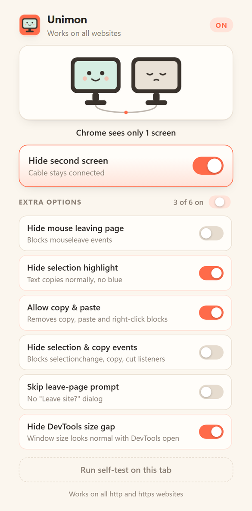
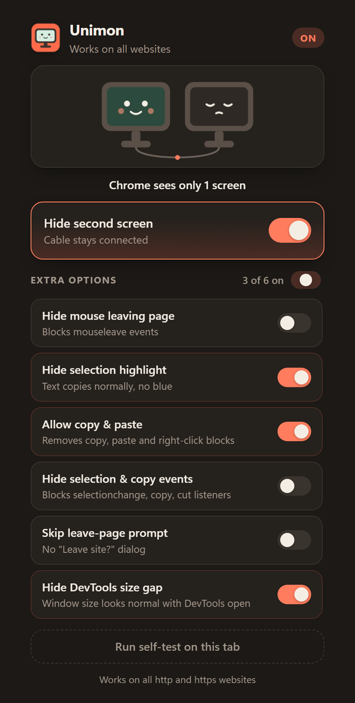

<div align="center">


# Unimon

### One monitor. Zero second-screen signals.

A tiny Chrome extension that makes the browser look like it has only a single screen,<br>
so you can see how **your own website** behaves when it can't spot a second display.

<br>

[](https://github.com/itsahmadnyc/unimon-chrome-extension/releases/latest)

[](LICENSE)

<br>

&nbsp;&nbsp;&nbsp;


</div>

<br>

## ✨ What it does

Flip the main switch and Unimon tells every website you open that:

| | The page sees | APIs covered |
| :-: | --- | --- |
| 🖥️ | Only **one** screen | `screen.isExtended`, `getScreenDetails()` |
| 📍 | The window is always **on the primary screen** | `screenX`, `screenY`, `availLeft`, `availTop` |
| 👀 | The tab is always **focused and visible** | `blur`, `visibilitychange`, `document.hasFocus()` |
| ⛶ | Fullscreen is still **fullscreen**, even if you step out | `fullscreenElement`, `fullscreenchange` |
| 📐 | A **consistent window size** | `innerWidth`, `outerHeight`, `resize`, `orientationchange` |
| 🎞️ | `matchMedia` agrees with all of it | `display-mode`, `resolution`, compound queries |

The toolbar icon falls asleep while Unimon is on, so you always know its state at a glance. 😴

## 🎛️ Extra options

Off by default. There is also an **All on / All off** master switch.

| Option | What it does |
| --- | --- |
| **Hide mouse leaving page** | Blocks `mouseleave` / `mouseout` when the cursor exits the window |
| **Hide selection highlight** | Removes the blue selection colour. Text still selects and copies normally |
| **Allow copy & paste** | Removes `user-select: none` and stops pages from cancelling copy, cut, paste, right-click and select |
| **Hide selection & copy events** | Stops pages from listening to `selectionchange`, `copy` and `cut` |
| **Skip leave-page prompt** | No "Leave site?" dialog |
| **Hide DevTools size gap** | Keeps `outerWidth` / `outerHeight` looking normal when DevTools is docked |

## 🧪 Self-test

Open any website, press **Run self-test on this tab** in the popup, and Unimon checks every feature and shows **OK**, **FAIL** or **SKIP** (when its switch is off).
If something fails while Unimon is on, reload the tab and run it again.

## 🚀 Install

Unimon isn't on the Chrome Web Store, so load it as an unpacked extension.

1. Download **`unimon-v1.0.0.zip`** from the [latest release](https://github.com/itsahmadnyc/unimon-chrome-extension/releases/latest) and unzip it.
   *(or clone the repo: `git clone https://github.com/itsahmadnyc/unimon-chrome-extension.git`)*
2. Open `chrome://extensions`.
3. Turn on **Developer mode** (top right).
4. Click **Load unpacked** and pick the unzipped folder.
5. Pin the icon, open the popup and flip the switch.

> After changing any file, press **Reload** on the extension card and refresh the tab you are testing.

## 🔧 How it works

Unimon registers small content scripts that run in the page's own JavaScript world (`world: "MAIN"`) at `document_start`, so they can override browser APIs before the website's code runs. Settings are kept in `chrome.storage.local`, and the background service worker registers or removes each script depending on your switches.

<details>
<summary><b>Project layout</b></summary>

```
manifest.json        extension config (Manifest V3)
background.js        registers / removes the scripts, icon and badge
popup.html/css/js    popup UI and the self-test
inject.js            core: screens, position, focus, fullscreen, size, matchMedia
inject-mouse.js      mouse-leave option
inject-copy.js       copy / paste option        (+ copy.css)
inject-track.js      selection and copy events option
inject-leave.js      leave-page prompt option
inject-devtools.js   DevTools size gap option
select.css           selection highlight option
icons/               toolbar icons (off and on)
docs/                README screenshots
```

</details>

## ⚠️ Limits

- It only changes what **JavaScript on the page** can see. It can't hide anything from the operating system, other software on your computer, or checks that a server does on its side.
- Not covered: console-getter tricks and `debugger` timing used to detect DevTools.
- `matchMedia` spoofing handles simple, `and` and comma queries. Newer nested or `or` syntax falls back to the real answer.
- Browser zoom and a different monitor scale both change `devicePixelRatio`, and a page can't tell them apart. Set your zoom before loading the page.
- It does nothing on `chrome://` pages, the Web Store, or other pages Chrome keeps off-limits to extensions.

## 🤝 Responsible use

Unimon is a **developer and testing tool**. Use it on your own websites and apps, or where you have permission, to check how they behave with a single screen.
Please don't use it to break the rules of an exam, assessment or any service you don't control. The software is provided as is (see the license), and you are responsible for how you use it.

## 📄 License

Released under the [MIT License](LICENSE).

<div align="center">
<sub>Made with 🧡 for people who test things properly.</sub>
</div>
